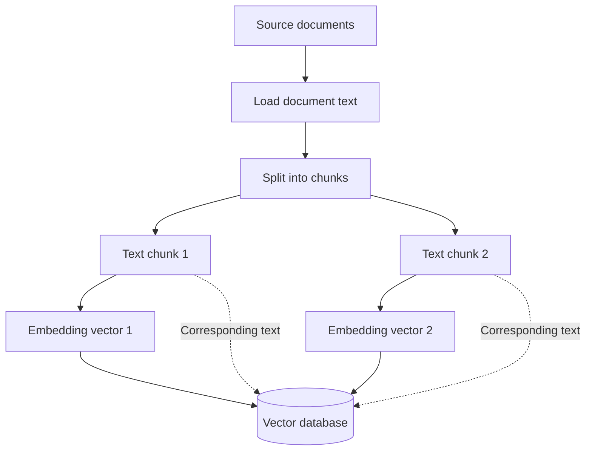
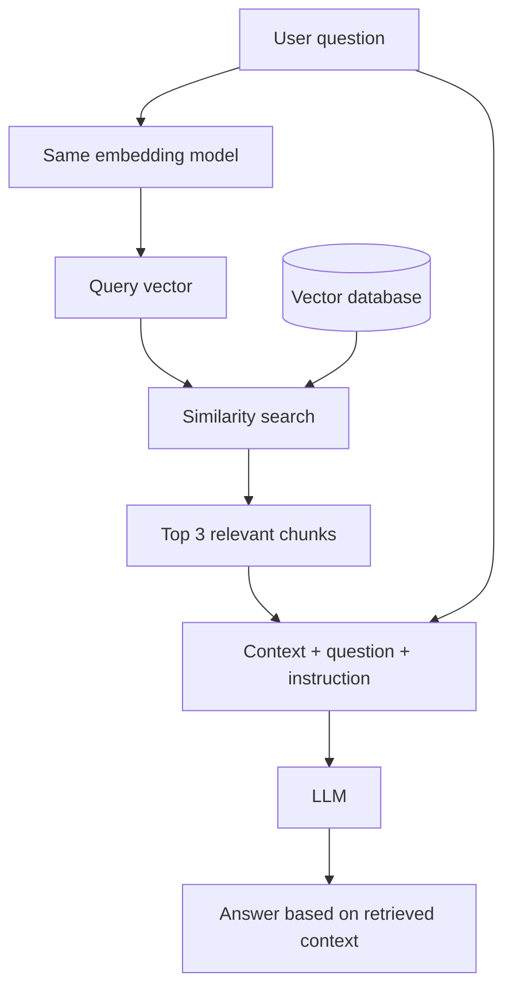
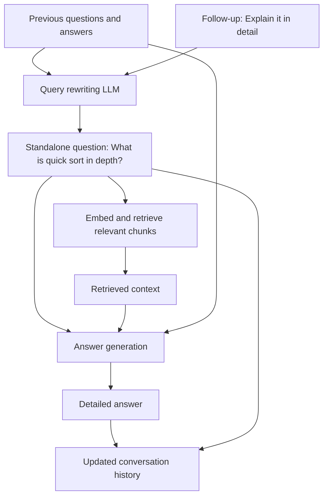

# RAG System — Retrieval-Augmented Generation

> **Documentation prepared and organized by ME **

Notes covering why RAG is needed, how its pipeline works, and how to implement a PDF-based RAG system using JavaScript, LangChain, Gemini, and Pinecone.

---

## Table of Contents

1. [Why Do We Need RAG?](#1-why-do-we-need-rag)
2. [What Is RAG?](#2-what-is-rag)
3. [How the RAG Pipeline Works](#3-how-the-rag-pipeline-works)
4. [Benefits of RAG](#4-benefits-of-rag)
5. [Project Setup](#5-project-setup)
6. [Phase One — Indexing Documents](#6-phase-one--indexing-documents)
7. [Phase Two — Answering Questions](#7-phase-two--answering-questions)
8. [Enhancing Follow-Up Questions](#8-enhancing-follow-up-questions)
9. [Complete Indexing Code](#9-complete-indexing-code)
10. [Complete Chat and Retrieval Code](#10-complete-chat-and-retrieval-code)
11. [Tooling and Evaluation](#11-tooling-and-evaluation)
12. [Documentation Credit](#12-documentation-credit)

---

## 1. Why Do We Need RAG?

Large Language Models can generate useful responses, but a model relying only on its training has several limitations.

### Knowledge Cutoff

An LLM is trained on information available up to a particular point. Its training alone does not provide information about later events.

**Example:** A model trained until 2023 would not know who won the 2025 Oscar for Best Picture from that training.

### Hallucinations

When an LLM does not know an answer, it may generate a plausible-sounding but incorrect response.

Generating likely text does not guarantee that the text is factually correct.

### Lack of Specific or Private Knowledge

A general-purpose LLM does not automatically know the contents of:

- A company's internal documents.
- Personal study notes.
- Private databases.
- Recent research papers from a specific field.

### The Core Problem

> How can we make an LLM answer questions using up-to-date, specific, or private information while reducing unsupported answers?

RAG addresses this problem by supplying relevant information before the model generates its response.

---

## 2. What Is RAG?

**RAG** stands for **Retrieval-Augmented Generation**.

| Term | Meaning |
|---|---|
| **Retrieval** | Find and retrieve relevant information from an external knowledge source. |
| **Augmented** | Add that information to the input provided to the LLM. |
| **Generation** | Let the LLM generate an answer using the supplied information. |

A RAG system retrieves relevant information, combines it with the user's question, and sends that combined input to an LLM.

### The Open-Book Exam Analogy

Imagine an intelligent student taking an exam.

| Approach | Analogy |
|---|---|
| **Standard LLM** | The student answers from memory. They may forget details or lack information about a specific topic. |
| **RAG system** | The student consults a textbook before answering and uses relevant information from it. |

> RAG gives the LLM a reference source to consult when answering a question.

---

## 3. How the RAG Pipeline Works

The RAG process has two main phases.

| Phase | Purpose | When It Happens |
|---|---|---|
| **Indexing** | Prepare documents so that relevant information can be retrieved. | Before answering questions, and when the knowledge base is updated. |
| **Retrieval and generation** | Retrieve relevant information and generate an answer. | Whenever a user submits a question. |

### Phase A — Preparing the Knowledge Base

#### Step 1: Load Documents

Collect the information the system should use.

Possible sources include:

- PDF files.
- Internal websites.
- Customer support tickets.
- Research papers.

#### Step 2: Split Documents into Chunks

Instead of supplying an entire large document for every question, divide it into smaller pieces.

These pieces are called **chunks**. They may represent paragraphs, pages, or sections of a chosen size.

#### Step 3: Create Embeddings

An **embedding model** converts each text chunk into a numerical representation called a **vector**.

Think of a vector as a coordinate representing the meaning of the text.

Texts with similar meanings tend to have nearby representations in the embedding space.

**Example:**

- “How much does a car cost?”
- “What is the price of an automobile?”

These sentences express similar meanings, even though their wording differs.

#### Step 4: Store Vectors and Text

Store the vectors together with their corresponding text so the system can retrieve relevant chunks later.

The original notes mention **Pinecone, Chroma, and FAISS** as options for vector storage or similarity search. The implementation below uses **Pinecone**.

### Indexing Diagram



The diagram shows two representative chunks. The same process applies to the remaining chunks.

### Chunk Size and Overlap

The complete indexing example uses:

| Setting | Value |
|---|---|
| `chunkSize` | `1000` |
| `chunkOverlap` | `200` |

The original diagram illustrates overlap using these simplified character ranges:

| Chunk | Illustrative Range |
|---|---|
| Chunk 1 | `1–1000` |
| Chunk 2 | `801–1800` |
| Shared range | `801–1000` |

The overlap keeps some text from the previous chunk in the next chunk.

### Phase B — Answering a Question

#### Step 1: Receive the User Query

Example:

> What are the new HR policies on remote work for 2025?

#### Step 2: Embed the Query

Convert the question into a vector using the **same embedding model** used for the document chunks.

#### Step 3: Retrieve Relevant Chunks

Search the vector database for chunk vectors that are closest to the query vector.

For the HR question, the retrieved information might discuss:

- Remote work.
- Work from home.
- Policies for 2025.

The conceptual explanation uses the top **3–5** relevant chunks. The original diagram illustrates **top 3**, while the JavaScript implementation uses **`topK: 10`**.

#### Step 4: Augment the Prompt

Combine the retrieved information with the question and an instruction.

```text
CONTEXT:

Chunk 1:
The new policy for 2025 states that employees can work
remotely up to 3 days a week.

Chunk 2:
Approval for remote work must be obtained from a direct manager.

Chunk 3:
All remote work must be conducted from within the country.

QUESTION:

What are the new HR policies on remote work for 2025?

INSTRUCTION:

Based only on the context provided above, answer the user's question.
```

#### Step 5: Generate the Answer

Send the augmented prompt to the LLM.

The model uses the supplied context to compose its response.

**Example answer:**

> According to the new HR policies for 2025, employees are permitted to work remotely for up to three days per week. This requires approval from a direct manager and must be conducted from within the country.

### Retrieval and Generation Diagram



**Diagram setting:** Top 3 is retained from the original illustration.  
**Implementation setting:** The code retrieves up to 10 matches using `topK: 10`.

### Course-Revenue Example from the Original Diagram

The original illustration also uses a document-based course-revenue question.

| Element | Original Example |
|---|---|
| Document context | Coder Army course documents |
| Question | “course ka revenue” |
| Retrieval | Relevant document chunks |
| Illustrative response | “1 lakh rupay” |

This is an example from the diagram, not a verified revenue statement.

---

## 4. Benefits of RAG

| Benefit | Explanation |
|---|---|
| **Access to updated information** | New documents can be added to the knowledge base and retrieved without retraining the entire LLM. |
| **Reduced hallucinations** | Asking the model to answer from retrieved context helps ground its response in the documents. |
| **Domain-specific knowledge** | The system can use information from a particular subject or organization. |
| **Private knowledge** | Internal documents can provide information that was never part of the model's training. |
| **Source citations** | Retrieved chunks can be traced to their source documents and pages. |
| **Cost efficiency** | Updating a retrieval knowledge base can be cheaper and faster than retraining or fine-tuning an entire model to incorporate new information. |

### Example Citation

> This answer was based on document `HR-Policy-2025.pdf`, page 4.

Knowing where an answer came from makes it easier to verify.

### Example Applications

- A chatbot for a company's internal wiki.
- An assistant that retrieves information from medical research.
- A tool that searches a specific collection of legal case files.
- A study assistant that answers questions from personal notes or PDFs.

---

## 5. Project Setup

The implementation uses JavaScript with LangChain, Gemini, and Pinecone.

### Packages

| Package | Role |
|---|---|
| `@langchain/community` | Provides the PDF document loader used in the example. |
| `@langchain/textsplitters` | Splits documents into chunks. |
| `@langchain/google-genai` | Provides the Google embedding integration. |
| `@langchain/pinecone` | Connects LangChain document embeddings with Pinecone. |
| `@langchain/core` | LangChain core package. |
| `@pinecone-database/pinecone` | Pinecone client for accessing and querying the index. |
| `@google/genai` | Gemini integration for query rewriting and answer generation. |
| `dotenv` | Loads environment variables. |
| `pdf-parse` | PDF parsing dependency included in the original setup. |
| `readline-sync` | Reads questions from the terminal. |

### Install Dependencies

```bash
npm i @langchain/pinecone @langchain/core @pinecone-database/pinecone @langchain/community @google/genai @langchain/google-genai @langchain/textsplitters dotenv pdf-parse readline-sync
```

### Environment Variables

Obtain the Gemini and Pinecone API keys and configure the environment variables.

```env
GEMINI_API_KEY=your_gemini_api_key
PINECONE_API_KEY=your_pinecone_api_key
PINECONE_ENVIRONMENT=us-east-1
PINECONE_INDEX_NAME=rohitnegi9
```

> API keys from the source notes have been replaced with placeholders. Keep actual keys out of GitHub. If the exposed keys are active, revoke or rotate them.

Load the environment variables:

```javascript
import * as dotenv from 'dotenv';
dotenv.config();
```

### Configuration Preserved from the Original Notes

| Setting | Value |
|---|---|
| PDF path | `./dsa.pdf` |
| Embedding model | `text-embedding-004` |
| Generation model | `gemini-2.0-flash` |
| Chunk size | `1000` |
| Chunk overlap | `200` |
| Retrieval count | `topK: 10` |
| Upload concurrency | `maxConcurrency: 5` |

The following snippets retain the original implementation logic and model identifiers. They are documentation examples and have not been runtime-tested as part of this conversion.

---

## 6. Phase One — Indexing Documents

This phase loads the PDF, splits it into chunks, creates embeddings, and stores the results in Pinecone.

### Step 1: Load the PDF

```javascript
import { PDFLoader } from '@langchain/community/document_loaders/fs/pdf';

const PDF_PATH = './dsa.pdf';
const pdfLoader = new PDFLoader(PDF_PATH);
const rawDocs = await pdfLoader.load();
```

Inspect the loaded documents:

```javascript
console.log(JSON.stringify(rawDocs, null, 2));
console.log(rawDocs.length);
```

### Step 2: Create Chunks

```javascript
import { RecursiveCharacterTextSplitter } from '@langchain/textsplitters';

const textSplitter = new RecursiveCharacterTextSplitter({
    chunkSize: CHUNK_SIZE,
    chunkOverlap: CHUNK_OVERLAP,
});

const chunkedDocs = await textSplitter.splitDocuments(rawDocs);
```

`CHUNK_SIZE` and `CHUNK_OVERLAP` represent the chosen settings. The complete example below uses `1000` and `200`.

Inspect the first two chunks:

```javascript
console.log(JSON.stringify(chunkedDocs.slice(0, 2), null, 2));
```

### Step 3: Initialize the Embedding Model

```javascript
import { GoogleGenerativeAIEmbeddings } from '@langchain/google-genai';

const embeddings = new GoogleGenerativeAIEmbeddings({
    apiKey: process.env.GEMINI_API_KEY,
    model: 'text-embedding-004',
});
```

The embedding model converts each text chunk into a vector.

### Step 4: Initialize Pinecone

```javascript
import { Pinecone } from '@pinecone-database/pinecone';

const pinecone = new Pinecone();
const pineconeIndex = pinecone.Index(process.env.PINECONE_INDEX_NAME);
```

### Step 5: Embed and Upload the Chunks

```javascript
import { PineconeStore } from '@langchain/pinecone';

await PineconeStore.fromDocuments(chunkedDocs, embeddings, {
    pineconeIndex,
    maxConcurrency: 5,
});
```

This connects the document chunks, embedding model, and Pinecone index.

---

## 7. Phase Two — Answering Questions

This phase takes a question, retrieves relevant document content, and generates a response.

### Step 0: Read Input from the Terminal

```javascript
import readlineSync from 'readline-sync';

async function main() {
    const userProblem = readlineSync.question("Ask me anything--> ");
    await chatting(userProblem);
    main();
}

main();
```

### Step 1: Convert the Question into a Vector

```javascript
import { GoogleGenerativeAIEmbeddings } from '@langchain/google-genai';

const embeddings = new GoogleGenerativeAIEmbeddings({
    apiKey: process.env.GEMINI_API_KEY,
    model: 'text-embedding-004',
});

const queryVector = await embeddings.embedQuery(question);
```

The query and document chunks use the same embedding model.

### Step 2: Retrieve Relevant Documents

```javascript
import { Pinecone } from '@pinecone-database/pinecone';

const pinecone = new Pinecone();
const pineconeIndex = pinecone.Index(process.env.PINECONE_INDEX_NAME);

const searchResults = await pineconeIndex.query({
    topK: 10,
    vector: queryVector,
    includeMetadata: true,
});

const context = searchResults.matches
    .map(match => match.metadata.text)
    .join("\n\n---\n\n");
```

| Part | Purpose |
|---|---|
| `topK: 10` | Requests the top 10 matching results. |
| `vector: queryVector` | Supplies the question's embedding for similarity search. |
| `includeMetadata: true` | Includes metadata with the returned matches. |
| `match.metadata.text` | Reads the stored text associated with each match. |
| `.join("\n\n---\n\n")` | Combines the retrieved text into a context string. |

### Step 3: Send the Question and Context to the LLM

```javascript
import { GoogleGenAI } from "@google/genai";

const ai = new GoogleGenAI({});
const History = [];

History.push({
    role: 'user',
    parts: [{ text: question }],
});

const response = await ai.models.generateContent({
    model: "gemini-2.0-flash",
    contents: History,
    config: {
        systemInstruction: `You have to behave like a Data Structure and Algorithm Expert.
    You will be given a context of relevant information and a user question.
    Your task is to answer the user's question based ONLY on the provided context.
    If the answer is not in the context, you must say "I could not find the answer in the provided document."
    Keep your answers clear, concise, and educational.

      Context: ${context}
      `,
    },
});

History.push({
    role: 'model',
    parts: [{ text: response.text }],
});

console.log("\n");
console.log(response.text);
```

The system instruction asks the model to:

1. Act as a Data Structure and Algorithm expert.
2. Answer using only the supplied context.
3. State when the document does not contain the answer.
4. Keep responses clear, concise, and educational.

The requested fallback response is:

> I could not find the answer in the provided document.

---

## 8. Enhancing Follow-Up Questions

A follow-up question may depend on previous messages.

### Example from the Original Diagram

| Conversation Part | Example |
|---|---|
| Initial question | “What is quick sort?” |
| Model response | An explanation of quick sort. |
| Follow-up | “Explain it in detail.” |
| Standalone rewritten question | “What is quick sort in depth?” |

The follow-up alone does not identify what “it” means.

Query rewriting uses the conversation history to produce a complete question before retrieval.

### Query-Rewriting Diagram



### Query-Rewriting Function

```javascript
async function transformQuery(question) {
    History.push({
        role: 'user',
        parts: [{ text: question }],
    });

    const response = await ai.models.generateContent({
        model: "gemini-2.0-flash",
        contents: History,
        config: {
            systemInstruction: `You are a query rewriting expert. Based on the provided chat history, rephrase the "Follow Up user Question" into a complete, standalone question that can be understood without the chat history.
    Only output the rewritten question and nothing else.
      `,
        },
    });

    History.pop();

    return response.text;
}
```

### How It Works

1. Temporarily add the current question to `History`.
2. Ask the model to rewrite it using the conversation history.
3. Remove the temporarily added question with `History.pop()`.
4. Return the standalone question.
5. Embed the rewritten question and retrieve relevant information.
6. Use the rewritten question and retrieved context to generate the answer.

In the complete implementation, the rewritten question and final answer are then added to the conversation history.

---

## 9. Complete Indexing Code

### `index.js`

```javascript
// PDF load karne ka index.js file
import * as dotenv from 'dotenv';
dotenv.config();

import { PDFLoader } from '@langchain/community/document_loaders/fs/pdf';
import { RecursiveCharacterTextSplitter } from '@langchain/textsplitters';
import { GoogleGenerativeAIEmbeddings } from '@langchain/google-genai';
import { Pinecone } from '@pinecone-database/pinecone';
import { PineconeStore } from '@langchain/pinecone';

async function indexDocument() {
    const PDF_PATH = './dsa.pdf';
    const pdfLoader = new PDFLoader(PDF_PATH);
    const rawDocs = await pdfLoader.load();

    console.log("PDF loaded");

    // Chunking karo
    const textSplitter = new RecursiveCharacterTextSplitter({
        chunkSize: 1000,
        chunkOverlap: 200,
    });

    const chunkedDocs = await textSplitter.splitDocuments(rawDocs);

    console.log("Chunking Completed");

    // vector Embedding model
    const embeddings = new GoogleGenerativeAIEmbeddings({
        apiKey: process.env.GEMINI_API_KEY,
        model: 'text-embedding-004',
    });

    console.log("Embedding model configured");

    // Database ko bhi configure
    // Initialize Pinecone Client
    const pinecone = new Pinecone();
    const pineconeIndex = pinecone.Index(process.env.PINECONE_INDEX_NAME);

    console.log("Pinecone configured");

    // langchain (chunking,embedding,database)
    await PineconeStore.fromDocuments(chunkedDocs, embeddings, {
        pineconeIndex,
        maxConcurrency: 5,
    });

    console.log("Data Stored succesfully");
}

indexDocument();
```

---

## 10. Complete Chat and Retrieval Code

This script preserves the original query-rewriting, retrieval, conversation-history, and response-generation logic.

```javascript
import * as dotenv from 'dotenv';
dotenv.config();

import readlineSync from 'readline-sync';
import { GoogleGenerativeAIEmbeddings } from '@langchain/google-genai';
import { Pinecone } from '@pinecone-database/pinecone';
import { GoogleGenAI } from "@google/genai";

const ai = new GoogleGenAI({});
const History = [];

async function transformQuery(question) {
    History.push({
        role: 'user',
        parts: [{ text: question }],
    });

    const response = await ai.models.generateContent({
        model: "gemini-2.0-flash",
        contents: History,
        config: {
            systemInstruction: `You are a query rewriting expert. Based on the provided chat history, rephrase the "Follow Up user Question" into a complete, standalone question that can be understood without the chat history.
    Only output the rewritten question and nothing else.
      `,
        },
    });

    History.pop();

    return response.text;
}

async function chatting(question) {
    // covert this question into vector
    const queries = await transformQuery(question);

    const embeddings = new GoogleGenerativeAIEmbeddings({
        apiKey: process.env.GEMINI_API_KEY,
        model: 'text-embedding-004',
    });

    const queryVector = await embeddings.embedQuery(queries);

    // query vector

    // make connection with pinecone
    const pinecone = new Pinecone();
    const pineconeIndex = pinecone.Index(process.env.PINECONE_INDEX_NAME);

    const searchResults = await pineconeIndex.query({
        topK: 10,
        vector: queryVector,
        includeMetadata: true,
    });

    // console.log(searchResults);

    // top 10 documents: 10 metadata text part 10 documebnt
    const context = searchResults.matches
        .map(match => match.metadata.text)
        .join("\n\n---\n\n");

    // create the context for the LLM

    // Gemini
    History.push({
        role: 'user',
        parts: [{ text: queries }],
    });

    const response = await ai.models.generateContent({
        model: "gemini-2.0-flash",
        contents: History,
        config: {
            systemInstruction: `You have to behave like a Data Structure and Algorithm Expert.
    You will be given a context of relevant information and a user question.
    Your task is to answer the user's question based ONLY on the provided context.
    If the answer is not in the context, you must say "I could not find the answer in the provided document."
    Keep your answers clear, concise, and educational.

      Context: ${context}
      `,
        },
    });

    History.push({
        role: 'model',
        parts: [{ text: response.text }],
    });

    console.log("\n");
    console.log(response.text);
}

async function main() {
    const userProblem = readlineSync.question("Ask me anything--> ");
    await chatting(userProblem);
    main();
}

main();
```

---

## 11. Tooling and Evaluation

### Tooling

The original notes mention **LangChain** and **LlamaIndex** as frameworks that simplify building RAG systems.

This implementation uses LangChain utilities for:

- Loading PDF documents.
- Splitting text into chunks.
- Creating embeddings.
- Connecting document embeddings to Pinecone.

### Evaluation

Two important questions help evaluate a RAG system:

| Area | Question |
|---|---|
| **Retrieval quality** | Did the system retrieve documents relevant to the user's question? |
| **Answer faithfulness** | Does the generated answer stay faithful to the retrieved information? |

Both stages matter: the system needs useful context and an answer grounded in that context.

---

## 12. Documentation Credit

**Prepared and organized by Shashank Sharma.**

This README documents the RAG concepts, examples, implementation steps, and code from the original notes. The diagrams have been redrawn in Mermaid for GitHub.

